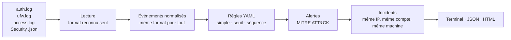

# Vigie

[](https://github.com/ChaheEnNSI/vigie/actions/workflows/ci.yml)


**Un petit SIEM en Python.** Vigie lit les journaux d’un système (Linux, Windows, serveur web, pare-feu), repère les attaques avec des règles lisibles reliées à MITRE ATT&CK, puis regroupe les alertes en incidents racontés dans l’ordre.

> Site du projet : **https://chaheennsi.github.io/vigie/** · Rapport de démonstration : [docs/rapport-demo.html](https://chaheennsi.github.io/vigie/rapport-demo.html)

*[English summary below](#english-summary)*

---

## Pourquoi

Un serveur écrit des milliers de lignes de journaux par jour. Une attaque y laisse presque toujours des traces : des échecs de connexion en rafale, une requête web bizarre, un compte créé à 21 h, un journal effacé… Mais personne ne lit tout. Vigie fait ce premier tri, comme le ferait un analyste de SOC : il signale ce qui sort de l’ordinaire et relie les morceaux d’une même attaque.

## Démo en 30 secondes

```bash
git clone https://github.com/ChaheEnNSI/vigie && cd vigie
pip install -e .
python -m vigie scan samples --year 2026 --tz Europe/Paris
```

```text
1887 événements lus (24 lignes ignorées)

28/10 20:58:00  MOYENNE   VIG-014  40 ports différents testés par 203.0.113.45 en 39 s
28/10 21:01:30  MOYENNE   VIG-013  Scanner détecté depuis 203.0.113.45 (61 requêtes)
28/10 21:04:05  HAUTE     VIG-010  30 requêtes d'injection SQL depuis 203.0.113.45 (ex. /produits.php)
…
28/10 21:14:05  CRITIQUE  VIG-003  Connexion réussie depuis 203.0.113.45 après une série d'échecs
…
28/10 21:45:00  CRITIQUE  VIG-007  Journal de sécurité effacé sur DC01.corp.local par jdupont

18 alertes (3 critique · 8 haute · 7 moyenne)
```

Le même résultat en rapport HTML autonome (incidents, chronologie, preuves, liens MITRE) :

```bash
python -m vigie scan samples --year 2026 --tz Europe/Paris -f html -o rapport.html
```

## Ce que Vigie détecte

| Règle | Détection | Gravité | MITRE ATT&CK |
|---|---|---|---|
| VIG-001 | Force brute SSH (8 échecs en 5 min depuis une même adresse) | haute | T1110.001 |
| VIG-002 | Pulvérisation de mots de passe (5 comptes différents en 10 min) | haute | T1110.003 |
| VIG-003 | Connexion réussie après une série d’échecs | **critique** | T1110, T1078 |
| VIG-004 | Compte Windows ciblé (10 échecs en 10 min) | moyenne | T1110 |
| VIG-005 | Ajout à un groupe à privilèges (Admins du domaine, sudo…) | haute | T1098 |
| VIG-006 | Création de compte | moyenne | T1136 |
| VIG-007 | Journal de sécurité Windows effacé | **critique** | T1070.001 |
| VIG-008 | Service installé depuis un dossier suspect | haute | T1543.003 |
| VIG-009 | PowerShell avec commande encodée | haute | T1059.001, T1027 |
| VIG-010 | Tentative d’injection SQL | haute | T1190 |
| VIG-011 | Tentative de XSS | moyenne | T1190, T1059.007 |
| VIG-012 | Traversée de répertoires (`../`, `/etc/passwd`) | haute | T1190, T1083 |
| VIG-013 | Scanner de vulnérabilités web (sqlmap, Nikto…) | moyenne | T1595.002 |
| VIG-014 | Scan de ports (15 ports en 2 min) | moyenne | T1046 |
| VIG-015 | Shell root ouvert avec sudo | moyenne | T1548.003 |

`python -m vigie rules` affiche la liste à jour.

## Comment ça marche



1. **Lecture.** Chaque ligne est reconnue toute seule (syslog SSH/sudo/useradd, pare-feu UFW/iptables, accès web au format *combined*, journal de sécurité Windows exporté en JSON). Ce qui n’est pas reconnu est compté, jamais perdu en silence.
2. **Normalisation.** Tout devient un `Event` avec les mêmes champs (`ts`, `source`, `action`, `user`, `src_ip`…). Une règle peut ainsi viser Linux et Windows à la fois (VIG-002, VIG-003).
3. **Règles.** Trois types : *simple* (un événement suffit), *seuil* (N événements, ou N valeurs différentes, dans une fenêtre glissante), *séquence* (une étape, puis une autre, pour la même adresse). Une attaque qui dure produit **une** alerte qui grossit, pas cent.
4. **Incidents.** Les alertes sont reliées comme le ferait un analyste : même adresse source, même compte compromis, ou à défaut même machine dans la demi-heure.
5. **Rapport.** Terminal, JSON (pour un autre outil) ou page HTML autonome.

## Sources prises en charge

| Source | Fichier | Exemple |
|---|---|---|
| Linux | `/var/log/auth.log`, `/var/log/secure` | `sshd: Failed password for root from 203.0.113.45 …` |
| Pare-feu | journal noyau UFW / iptables | `kernel: [UFW BLOCK] SRC=… DST=… DPT=22` |
| Web | journal d’accès Apache / Nginx (*combined*) | `203.0.113.45 - - [28/Oct/2026:21:04:05 +0100] "GET /…"` |
| Windows | journal Security exporté en JSON | voir ci-dessous |

Pour exporter les événements Windows utiles (4624, 4625, 4688, 4720, 4728, 4732, 4756, 1102, 7045), en administrateur :

```powershell
powershell -ExecutionPolicy Bypass -File .\scripts\export-windows-security.ps1 -Heures 24 -Sortie .\windows-security.json
```

## Écrire une règle

Une règle est un fichier YAML. Celles fournies avec Vigie sont dans `vigie/detections/` ; pour utiliser les vôtres, indiquez leur dossier avec `-r mes-regles/`. Exemple, la force brute SSH :

```yaml
id: VIG-001
title: Force brute SSH
severity: high
mitre: [T1110.001]
match:
  source: linux
  action: auth_failure
threshold:
  group_by: src_ip
  count: 8
  window: 5m
message: "{count} échecs de connexion SSH depuis {src_ip} en {duration}"
```

Conditions disponibles : égalité (insensible à la casse), liste de valeurs, `contains`, `startswith`, `regex`, `not`, `gte`, `exists`. Une règle mal écrite est refusée au chargement avec un message clair.

## Le scénario de démonstration

`samples/` contient une journée de journaux **simulés** pour une petite entreprise (un serveur web, un pare-feu, un contrôleur de domaine), générés par `samples/generate.py` avec une graine fixe. Dans le bruit normal (connexions, fautes de frappe, trafic web, bruit d’Internet) se cachent deux attaques :

- **203.0.113.45** scanne les ports, passe le site au crible (Nikto, sqlmap), tente XSS et traversée de répertoires, force l’accès SSH, réussit sur le compte `deploy`, ouvre un shell root, crée un compte `backup2` et l’ajoute au groupe `sudo`.
- **198.51.100.23** pulvérise des mots de passe sur dix comptes, martèle le compte `administrateur`, entre avec `jdupont`, lance un PowerShell encodé, crée un compte administrateur, installe un service dans `C:\Users\Public` et efface le journal de sécurité.

Résultat, vérifié par les tests à chaque modification : **les 18 étapes attendues sont détectées, sans aucune fausse alerte sur le bruit de fond, et les deux attaques sont reconstituées en deux incidents.** Ces données sont synthétiques : sur un vrai système, les seuils sont à ajuster à l’activité normale.

## Tests et qualité

```bash
pip install -e ".[dev]"
pytest -q          # 25 tests : formats, conditions, seuils, séquences, scénario complet, rapport
ruff check .
```

L’intégration continue (GitHub Actions) relance tout sur Python 3.10, 3.12 et 3.13, vérifie que les journaux de démo correspondent bien au générateur, et publie le rapport HTML en artefact.

## Sécurité de l’outil lui-même

Un outil qui lit des journaux lit des données écrites par des attaquants. Donc :

- les règles sont chargées avec `yaml.safe_load` (jamais d’objet Python arbitraire) ;
- tout ce qui vient des journaux est échappé dans le rapport HTML : un `<script>` glissé dans une URL s’affiche, il ne s’exécute pas (test dédié) ;
- le rapport porte une politique de sécurité stricte (CSP `default-src 'none'`) : aucun script, aucune ressource externe ;
- aucun accès réseau, une seule dépendance (PyYAML).

## Limites et suite

- Analyse de fichiers, pas en temps réel : la suite logique est un mode `--follow` qui lit les journaux au fil de l’eau.
- Corrélation volontairement simple (adresse, compte, machine).
- Pistes : import de règles [Sigma](https://github.com/SigmaHQ/sigma), journaux Sysmon, export vers Elastic, enrichissement hors ligne (listes d’adresses malveillantes), labo Docker pour rejouer de vraies attaques.

---

## English summary

**Vigie** is a small Python SIEM. It reads Linux auth logs, UFW/iptables firewall logs, web access logs and Windows Security events (exported as JSON), normalises them into one event format, runs 15 YAML detection rules mapped to MITRE ATT&CK (simple, threshold and sequence rules), groups alerts into incidents, and outputs a terminal table, JSON or a self-contained HTML report. A deterministic simulated scenario with two hidden attacks is included; the test suite checks that all 18 attack steps are detected with no false positive on the background noise.

```bash
pip install -e . && python -m vigie scan samples --year 2026 --tz Europe/Paris -f html -o report.html
```

## Licence

MIT — © 2026 Chahé Papazian
